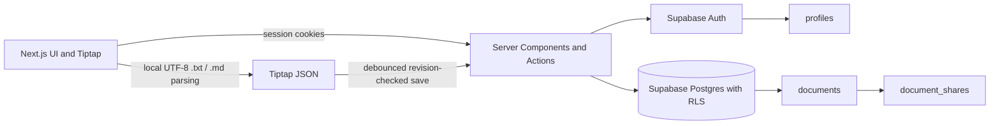

# Draftly

Draftly is a polished document workspace for writing, importing Markdown/text, and sharing documents with viewer or editor access.

## Stack

Next.js App Router and TypeScript provide server-rendered workspace pages and server actions. Supabase Auth and PostgreSQL persist accounts, documents, and shares; RLS is the enforcement boundary. Tiptap JSON is the canonical editor format. The interface uses semantic React controls and a small custom CSS design system rather than adding a component library.

## Architecture



- **Authentication and access:** Server components and actions use the signed-in user's cookie-bound Supabase session. Each protected action verifies the user; PostgreSQL row-level security enforces document ownership and viewer/editor permissions. The app does not use a service-role key.
- **Document lifecycle:** The workspace creates documents through a server action. Creation inserts with a generated ID and no returned row, then reads the new ID separately. Tiptap JSON is validated before it is saved; autosave uses revision checks to avoid silently overwriting concurrent edits.
- **Import and collaboration:** Text and Markdown files are validated and parsed locally into Tiptap JSON; originals are not uploaded. Sharing is performed through authenticated server actions and existing database permission checks.
- **Configuration safety:** Keep local environment files out of version control. Configure project-specific values in local or deployment environment settings; never put passwords, access tokens, or service-role credentials in source code or `NEXT_PUBLIC_*` variables.

## Local setup

1. Create a Supabase project and copy `.env.example` to `.env.local`.
2. Set `NEXT_PUBLIC_SUPABASE_URL` and `NEXT_PUBLIC_SUPABASE_PUBLISHABLE_KEY`. Existing projects may use `NEXT_PUBLIC_SUPABASE_ANON_KEY` instead.
3. Apply the SQL migrations in `supabase/migrations` in timestamp order in the Supabase SQL Editor, or run `supabase db push`.
4. Set `NEXT_PUBLIC_SITE_URL=http://localhost:3000` locally and enable email/password sign-in in Supabase Authentication. Add `http://localhost:3000/auth/confirm` to the allowed redirect URLs.
5. Install and start:

   ```sh
   npm install
   npm run dev
   ```

New users must confirm email if confirmation is enabled in the Supabase project. Profiles are created automatically when the auth user is created.

## Features

- Email/password sign-up, sign-in, and sign-out.
- Responsive workspace with search and owned/shared document lists.
- Tiptap rich-text editing: bold, italic, underline, headings, lists, links, blockquotes, undo, and redo.
- Debounced title/content autosave with revision checks and retry feedback.
- Import `.txt` and `.md` files up to 1 MB. Strict UTF-8 validation rejects empty, binary, malformed, or unsupported files before document creation; Markdown is converted locally to editable Tiptap JSON and HTML is never executed.
- A persistent light/dark theme and an editor outline that follows document headings.
- Share with existing registered email addresses as viewer or editor; change permission or revoke access.

## Checks

```sh
npm run lint
npm run typecheck
npm test
npm run build
```

The unit tests do not require Supabase credentials. Imports intentionally match the assessment's accepted `.txt` and `.md` formats; PDF and legacy Word `.doc` files are not accepted. The upload limit is 1 MB (1,000,000 bytes).

### Two-account sharing test

1. In the Supabase Dashboard for a **development project**, open Authentication → Users and create two test users with distinct email addresses. Confirm each test user's email in the Dashboard (or use the per-user email-confirmation option when adding them). Do not disable email confirmation globally.
2. Verify the Dashboard shows two different user IDs. Use unique, locally managed passwords; do not save them in this repository or frontend code.
3. Sign in to Draftly as User A, create a document, then share it with User B's registered email as **Viewer**.
4. Sign out and sign in as User B. Open the shared document and verify its content and title are readable, but editing and deletion are unavailable. Attempt the document URL as a signed-out user or a third unshared user and verify access is denied.
5. Sign back in as User A, change User B to **Editor**, then sign in as User B again. Verify title/content changes save. User B must not be able to change sharing permissions.
6. As User A, revoke User B's access. Reload User B's session and verify the shared document disappears from the workspace and its direct URL no longer opens.
7. Remove the development test users from Authentication → Users when finished. Do not reuse production accounts or disable RLS for this test.

These are manual checks against the connected development Supabase project; unit tests do not establish live RLS behavior.

Document creation inserts with a generated UUID without `RETURNING`, then fetches the new row in a separate SELECT. This avoids combining INSERT and SELECT policy checks in one PostgREST request. In development, the server action logs only the failing stage and safe database code/message; it never logs credentials or document content. The old `debug_auth_context` helper and its SQL are retained only as a manual diagnostic artifact; the application no longer calls the RPC. If the function was installed in a Supabase project, verify that no external SQL/dashboard tooling depends on it before removing it.

## Deployment

Deploy the repository to Vercel, add the Supabase URL and publishable key plus the production `NEXT_PUBLIC_SITE_URL`, and deploy. Apply the migration to the connected Supabase project and set the production Site URL and allowed redirect URLs under Authentication settings. For CLI migrations, initialize/link the Supabase project before `supabase db push`. Keep all service-role keys server-only; Draftly does not require one.

## Security and limitations

The browser and server use the Supabase publishable/anon key with the signed-in user's session. RLS enforces ownership, editor/viewer access, and owner-only sharing. Email lookup and collaborator listing use narrow security-definer database functions. The app does not use a service-role key, upload originals to Storage, provide real-time collaboration, or implement version history. Sharing is limited to already registered users; Draftly does not send invitations.

## AI workflow note

### AI tools used

I used GitHub Copilot Chat and ChatGPT as development assistants throughout the Draftly assignment.

### How AI helped

AI helped accelerate codebase exploration, implementation planning, UI refinement, component development, test creation, and debugging. I used it to explore implementation options and identify potential edge cases across document editing, file import, sharing, and authentication.

### Human judgment and decisions

I remained responsible for deciding what to build within the time limit, reviewing generated changes, and prioritizing a reliable core workflow over attempting to reproduce all of Google Docs. I also reviewed suggestions against the existing architecture and requirements rather than accepting generated code blindly.

For example, I prioritized preserving Supabase authentication and row-level security instead of bypassing access controls to work around document-creation issues. I kept file import intentionally scoped to the supported formats and documented limitations rather than claiming unsupported functionality.

### Verification

I used automated tests, linting, TypeScript checks, and a production build to catch regressions. I also inspected the application in the browser. These checks complement, but do not replace, end-to-end verification of authentication, persistence, and sharing against the deployed Supabase project.

### What I would improve next

With more time, I would expand end-to-end permission tests, improve collaboration feedback, and implement notifications for shared-document updates, including in-app alerts and email notifications with appropriate delivery controls.

AI accelerated implementation, but I treated its output as a starting point. I remained accountable for the technical decisions, security considerations, scope, and validation of the final product.
