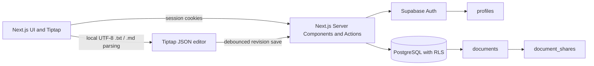

# Architecture

## Data relationships

- `profiles.id` references `auth.users.id`; a database trigger creates each profile.
- `documents.owner_id` references the owner in `auth.users`. Documents have a JSONB Tiptap `content` field and integer `revision`.
- `document_shares` joins documents to registered recipients, with one `viewer` or `editor` permission per document/user.
- Deleting a user cascades their profile, documents, and shares. Deleting a document cascades its shares.

## Document and autosave flow

The workspace is rendered on the server using the current Supabase session. Document creation, deletion, saving, and sharing use server actions and verify the authenticated user. Tiptap's JSON—not rendered HTML—is validated and persisted. After 800 ms without edits, the editor submits title, JSON content, and the current revision. PostgreSQL updates only when that revision matches and increments it; a mismatch is shown as a conflict rather than silently overwriting newer content. Changes made during an in-flight save are submitted afterward.

Imports accept non-empty UTF-8 `.txt` and `.md` files up to 1,000,000 bytes. Extension and known MIME types are checked before reading; malformed UTF-8, NUL-containing binary data, empty content, and oversized files fail before document creation. Markdown is converted to Tiptap JSON without rendering imported HTML. The server action validates the resulting Tiptap document before persistence. The original file is not stored. PDF and legacy Word `.doc` are deliberately unsupported because they are outside the assessment's stated import formats.

The editor outline is derived from the current Tiptap JSON and refreshed when editor content or selection changes. Theme choice is stored in browser local storage and applied before hydration to avoid an initial theme flash; it does not affect authentication or persisted document data.

## Authentication, sharing, and RLS

Supabase Auth supplies the identity. Server actions call `auth.getUser()` and use a cookie-bound Supabase client, never a service-role client. Table RLS enforces owner/editor/viewer behavior even if a UI control is bypassed. Narrow security-definer helpers with a fixed empty search path evaluate access without recursive RLS. Only owners can manage shares. Email-based sharing looks up existing accounts inside a guarded RPC; collaborator emails are returned only to the document owner. Profiles are visible only to their own user; collaborator display names are exposed only in that owner-checked function.

## Tradeoffs

- Sharing works only for registered users; there is no invitation email service.
- Autosave uses optimistic revision checking but is not real-time collaboration.
- Version history and Supabase Storage are intentionally omitted.
- The database checks the Tiptap document envelope and size/shape safety is validated in server actions; database RLS is the authorization authority.
